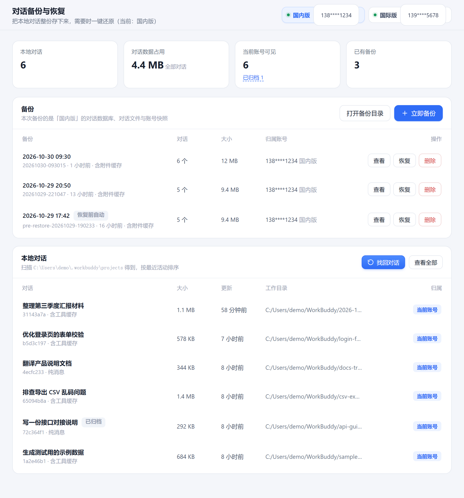

# WorkBuddy 对话管家 · Beta

给 WorkBuddy 的对话做**备份**、**恢复**和**找回**，另外可以管理客户端里的**自定义模型清单**。
支持国内版和国际版。

纯 PowerShell 脚本 + 一个本地网页界面，解压即用：不用安装、不装依赖。
Windows 10 / 11 自带的 PowerShell 5.1 就能跑。

---
## 我什么时候需要它？

| 事件 | 用法 |
|:----:|:----:|
| 买新电脑 | 老电脑备份 → 新电脑恢复，仅需复制本项目所在文件夹 |
| 重装软件 | 卸前备份 → 装完恢复，对话全部找回来 |
| 更换账号 | 找回历史对话，不用重新聊一遍 |
| 误删对话 | 还原被删对话，人生不再有遗憾|
| 配模型 | 批量导入 + 能力补全，不用在客户端里一条条填 |

## 一、备份

点「立即备份」，把当前版本的**对话数据库、全部对话文件**打成一个包，存到程序目录的
`backups\<时间戳>\` 下。每一份备份都带一个 `manifest.json`，记录时间、对话数量、体积和内容清单。

- 备份是**整份快照**，不是增量，可以随时拿任意一份回到那个时刻。
- 支持只备份消息、不含附件缓存（体积小很多），也支持连附件一起打包。
- 备份列表里能直接看到每份备份的对话数、大小、归属账号；点「查看」可以看到里面有哪些对话。

## 二、恢复

选中一份备份点「恢复」，三种方式：

| 方式 | 做什么 | 什么时候用 |
|---|---|---|
| **完整恢复** | 把对话库整个回滚到备份那一刻，备份之后新增的对话会从列表里消失 | 想整体回到某个时间点 |
| **自定义恢复** | 点「确认恢复」后弹出第二个清单，**只列备份里的对话**，按差异分四组、左右两栏（备份 / 本地）对照，由你逐条选；**只有选了「备份」的**才会被覆盖或补入 | 想自己逐条挑哪些用备份的、哪些保留本机的 |
| **仅补齐缺失** | 备份里有、这台机器上没有的才补进来，已有的不覆盖、不删除 | 换机器、换账号、只想把丢的捞回来 |

**完整恢复**和**自定义恢复**动手前都会先给当前状态自动做一份备份（名字以 `pre-restore-` 开头），
恢复错了可以退回去。**自定义恢复**的清单只列备份里的对话（云端已过滤、本机独有的不显示也绝不删除），
由你逐条在「备份 / 本地」间单选，没改动的按该组预选走（「不选 = 按组默认」）；
最终**只有选了「备份」的对话**会被覆盖或补入，其余一律不动。

## 三、找回对话

WorkBuddy 把每个对话记在数据库里，每行带一个归属账号。换了账号之后，对话文件明明还在，
但归属还是旧账号，侧栏里就看不见了。

点「找回对话」会扫出所有**当前登录账号**不可见的隐藏对话，按来源账号分组列出来：

- **正常对话、已归档对话** —— 默认勾选
- **已删除对话** —— 默认不勾，需要反悔时自己勾上

勾选后点「找回」：

- 只改归属，**对话正文一个字都不碰**
- 已归档的对话找回后**仍然是归档状态**
- 已删除的对话找回后**取消删除**，重新回到列表里
- 处理前可以选择是否先做一份完整备份（默认开）

云端对话（`transport = cloud`）的归属记在服务端，本地改不了，所以不在候选里，界面会单独提示有几个。

---

## 四、查看全部与彻底删除

「本地对话」卡片右上角的「查看全部」列出数据库里的**全部**对话——包括侧栏里看不到的已归档、
已删除，以及云端对话。

- 筛选分两行：第一行按账号（默认当前登录的），第二行按状态：**全部 / 可见 / 归档 / 删除 ┃ 云端**。
- 「全部」是前三档的合计。**云端单独一档**，只有点「云端」才看得见，不会被混进可见 / 归档 / 删除里。
- 「状态 / 设置」那一列点一下就能改，但**客户端必须关着**：它持着数据库并缓存页面，
  开着的时候改下去会被它覆盖回去。
- 云端对话的状态记在服务端，本地只能看不能改，显示为只读标记：`云端 · 只读` /
  `云端 · 已归档` / `云端 · 已删除`。

底部的红色「彻底删除」是**真删**——清空已删除的对话，连同对话文件、附件缓存和侧栏缓存里的
条目一起删掉，只保留数据库里仍然处于删除状态的那些。动手前默认先做一份完整备份，删错了
只能靠它恢复。

主界面上那三个数字（本地对话 / 当前账号可见 / 已归档）和卡片里的对话列表都**只数本地对话**，
云端不计入，这样数字和列表行数永远对得上。

## 五、账号切换

客户端换号之后，旧号的对话文件还在，但归属变了，侧栏里就看不见了。本程序的做法是把
登录态**整份存成快照**，想切哪个号就把哪份覆盖回去：

1. 在客户端登录账号 A，回到本程序点「保存当前登录」。
2. 在客户端换成账号 B，再点一次「保存当前登录」。
3. 之后在账号卡片上点「切换到此账号」，两种方式：
   - **切换并重启**：存当前登录态 → 关客户端 → 覆盖登录态文件 → 重新启动
   - **仅切换**：只换登录态、不启动客户端，什么时候开自己点「打开客户端」

几点要知道：

- 登录态还剩几天直接标在卡片上（剩 7 天变红、剩 20 天变黄）。`refreshExpiresAt` 每续期
  一次就重置为「当时 + 30 天」，所以 30 天内在客户端里开过这个号，它就是活的。
- 客户端每次续期都会换一份新的 refresh token 并把旧的作废。程序每 20 秒同步一次快照，
  就是为了堵这个洞——否则切过去照样要重新登录。
- **不要在客户端里手动切号**：那样会直接覆盖登录态文件，被切走的号如果没存过快照，就得重新登录。
- 国内版和国际版的账号物理隔离（分别存在 `profiles\workbuddy-desktop\` 和
  `profiles\workbuddy-desktop-ai\`），账号列表只列当前所选版本的。
- 程序只是把登录态文件整份复制进 / 复制出，不解密、不修改内容。

---

## 六、模型管理

管理客户端里那份**自定义模型清单**（`models.json`）。客户端只读这一个文件，所以这一页
改的就是它。

**卡片上有什么**：一行是「显示/隐藏开关 → 图标 → 备注：id」，右边是 编辑 / 测试 / 删除。
测试结果直接显示在下方「接口」那一行的右端（绿字可用 / 红字不可用），不占额外一行。

**批量导入**（右上角蓝色按钮）——一次把一个端点下的模型全加进来：

1. 填接口地址和密钥，点「获取列表」。地址只填域名也行，程序会依次试
   「原样 → 域名/models → 域名/v1/models → 地址/models」并把试过的都列出来。
2. 清单默认全选。点「测试对话」可以整批验证，有进度条，逐行变绿/变红；测不过的自动取消勾选。
3. 填个备注，点「批量保存」。

**能力补全（`model.csv`）**——程序目录下有一个 `model.csv` 模板，用来补接口没说清的字段：

- 首列是模型 id，**支持 `*` 通配符**，而且 `*` 可以放在**开头**（`glm-*` 匹配所有 glm- 开头，`glm-5.3*` 匹配 `glm-5.3` / `glm-5.3-flash` / `glm-5.3-highspeed`）
- 后面的列：支持工具 / 支持图片 / 支持思考 / 推理档位 / 默认档位 / 上下文长度 / 输出长度 / 隐藏 / 图标
  （「上下文长度」= 输入上限，`maxInputTokens`；「输出长度」= 输出上限，`maxOutputTokens`，两列独立）
- 取值优先级：**接口返回的 > csv 匹配项（先精确后通配）> 默认值**
- 表头中英文都认；布尔值认 是/否、开/关、1/0、true/false

**同一个模型有好几种 id 写法**，模板里每家都写了三条：

| 写法 | 例子 | 匹配用的模式 |
|---|---|---|
| 裸的 | `gpt-6-astra` | `gpt-*` |
| 斜杠前缀 | `openai/gpt-6-astra` | `*/gpt-*` |
| 点前缀 | `openai.gpt-6-astra`、`global.openai.gpt-5.6-sol` | `*.gpt-*` |

只写裸的那种，带前缀的 id 一条都匹配不上，只能吃程序默认值（连上下文长度都不会写进去）。

原始数据留档在 `docs/` 目录里，方便核对：内置清单 1011 条（`builtin-models.json`）
和两版「添加自定义模型」的**远端配置**（`preset-models-intl.json` / `preset-models-cn.json`，
各 162 / 160 条）——后者才是客户端实际在用的那份，安装包里的表只是拉取失败时的兜底。

模板里已经按这两份数据**预填好了常见系列**
（DeepSeek / GLM / Kimi / MiniMax / 通义千问 / OpenAI GPT 与 o 系列 / Claude / Gemini / Grok / Mistral / Llama 等）
的能力、档位和上下文长度，所以绝大多数情况下**你什么都不用改**；遇到没预填的模型再加行即可。

带 `*` 的行之间是有先后的：自上而下第一个命中即生效，所以越具体的写法要越靠前，
否则 `deepseek-v4-pro-0813` 会被前面某条更宽的 `deepseek-*` 先截走；同理
`gpt-oss*`（16 万上下文）也必须排在 `gpt-*`（105 万）之前，不然开源小模型会被套成旗舰参数。
模板里这些顺序都已经排好了。

**分组（标签页）**——顶部标签页对应同一目录下的多个清单文件。点「+」新建一组，
切过去就是换一份清单；右键标签页可以 改名 / 测试 / 编辑 / 删除。
停放的分组存成 `models<标题>.json`（标题放在扩展名前面）。

**几个细节**：

- 「隐藏」是把键名 `id` 改成 `-id`，条目本身完整保留，随时能开关回来。
- 同一个 id 有两条时（重复导入过），客户端只用一条；本程序保证**最多一条可见**。
- 每条卡片的按钮都带「id + 位置」，所以点隐藏那张卡片的操作只会作用在隐藏那条上。

---

## 快速开始

0. 点[Download ZIP](https://github.com/batvbs/WorkBuddy-History/archive/refs/heads/Beta.zip) 或 [下载ZIP](https://gitee.com/batvbs/work-buddy-history/repository/archive/Beta.zip)
1. 下载后解压到任意目录（路径带中文也没关系）
2. 双击 `启动 WorkBuddy 对话管家.vbs`（后台启动，不会弹出黑色命令行窗口）
3. 浏览器会以应用窗口打开界面，默认就在「对话备份」页

左下角两个按钮：

- **桌面图标** —— 在桌面建「WorkBuddy 对话管家」快捷方式。桌面被重定向到 OneDrive、
  目录只读或被安全软件拦下时，会改建在程序自己所在的目录里，并告诉你建在了哪。
  弹出的结果窗里也有一个「打开应用目录」按钮，方便直接去程序目录里双击 vbs。
- **退出程序** —— 关掉后台进程（不影响 WorkBuddy 客户端）。

## 运行要求

- Windows 10 / 11
- 系统自带的 PowerShell 5.1（无需安装任何东西）
- 界面用 Edge 或 Chrome 以应用窗口方式打开（系统自带 Edge 即可）

## 它是怎么做到的

- 对话以 **SQLite 数据库**为准（`%USERPROFILE%\.workbuddy\workbuddy.db` 等），
- 数据库是 **WAL 模式**。程序通过 Windows 自带的
  `winsqlite3.dll` 执行 SQL
- 备份里如果带着没合并的事务日志（`-wal`），程序会先把数据库和日志一起复制到临时目录，
  让 SQLite 自己把日志合并进去，得到一份干净的库再操作。
- 所有路径都从环境变量现算（`%USERPROFILE%`、`%LOCALAPPDATA%` 等），
  不写死任何绝对路径，换台机器、换个用户名都能直接用。

## 安全边界

- 程序只监听 `127.0.0.1`，每次启动随机生成访问令牌；打开界面的地址里就带着这个令牌，
  不带令牌既打不开界面、也调不动任何接口。这是「防误触 / 防别的网页碰到」，不是安全边界：
  能在这台机器上跑程序的人，本来就能直接读改你的模型文件。
- **对话、账号、备份都在本机处理，不会上传到任何第三方。** 唯一的例外是「模型管理」里你
  主动点的「测试对话 / 获取列表 / 批量导入」——那些会按**你自己填的接口地址**发请求
  （本程序不认识也不内置任何服务商）。除此之外不发起网络请求，也没有检查更新功能。
- 程序自己产生的数据都在解压目录下的 `data\`、`backups\` 里，删掉程序目录就等于全部清理干净。
- 关掉窗口后后台进程会在十几秒内自己退出，不留残留文件；也可以点左下角「退出程序」。

## 常见问题

**Q：备份会不会把别的账号的对话也带走？**
会。备份是整份数据库快照，不按账号过滤，所以恢复后可能需要用「找回对话」把归属改回来。

**Q：还原之后客户端里看不到？**
客户端启动时会重建侧栏缓存，等它初始化完成即可。如果还是看不到，对话归属可能不是当前账号，需要用「找回对话」把归属改回来。

## 近期更新

| 版本 | 主要变化 |
|---|---|
| v1.9.20 | 「立即备份」弹窗底栏加「关闭客户端」（客户端在跑时出现，关完窗口自动重开、按钮消失）；按 CR 修清理误删文件、备份绕过 10 秒索引缓存、备份/恢复的文件复制失败不再被吞并如实提示、启动参数给含空格路径加引号、找回与模型保存的异步跨版本污染。 | 
| v1.9.19 | 附件复制把父目录也纳入预留，搬迁文件不会再抢走其他对话需要的目录名，真实附件不会落到错误路径。 | 
| v1.9.18 | 分叉、打开客户端也接住刷新结果：列表没刷出来时明确提示，不再默认报「完全成功」。 | 
| v1.9.17 | 清单弹窗加归属校验：关掉后旧请求的结果直接丢弃，不会改到新弹窗的计数与确认按钮。 | 
| v1.9.16 | 归属勾选项副标题精简为「只改归属，不动内容」；分组头与全选区之间的细缝恢复为无响应区。 | 
| v1.9.15 | 分组头保留与全选区之间的细缝（视觉不变），该处点击同样能展开/折叠。 | 
| v1.9.14 | 自定义恢复清单的分组头整行可点（原来中间空白是死区），右侧「全选」区保持原样。 | 
| v1.9.13 | 附件去重只比对「本次已写入」的真实路径，避免与稍后被覆盖的名字误判而丢文件。 | 
| v1.9.12 | 目录占位导致的改名也走去重，重复恢复不再堆积 -innerN 副本。 | 
| v1.9.11 | 附件落位规则再收紧：回退改名的文件按去重/另存处理，真实路径的名字预先预留，结果与遍历顺序无关，冲突时两份都在。 | 
| v1.9.10 | 恢复的覆盖语义恢复：真实路径的附件直接替换本地（目录占位除外），拍平副本才另存；候选名耗尽抛错不再静默跳过；Strict（分叉）下不允许悄悄改布局。 | 
| v1.9.9 | 拍平复制改为「原名 → -inner1 → -inner2」顺序分配，按 SHA256 判重、目录占位不覆盖、结果不依赖遍历顺序，重复恢复不会多出副本。 | 
| v1.9.8 | 附件复制改为「恢复时拍平自嵌套、备份与分叉忠实复制」，任何文件都不丢；同名不同内容两份都保留（另存 -innerN）。 | 
| v1.9.7 | 修备份一次比一次大：附件目录被恢复逻辑套娃（每次恢复多一层，30 个会话重复占 507MB），复制改为逐文件、跳过自嵌套副本；「找回对话」勾到其他账号时提示会把归属移走。 | 
| v1.9.6 | 刷新与关闭客户端的异步结果加校验：窗口已在请求期间关掉就丢弃结果、没读到真实状态就不谎报「已关闭」。 | 
| v1.9.5 | 自定义恢复的「改写归属」不再因「备份本就属于当前账号」被禁用，混账号备份里其他账号的对话也能一并改写。 | 
| v1.9.4 | 修三处：恢复前的安全备份改用关闭后的真实索引（避免漏备刚新建的对话）、分叉请求在途时不允许关窗重提交（避免产生两份副本）、关闭客户端后按实际状态给结论。 | 
| v1.9.3 | 自定义恢复清单：标题显示「已选/全部」、窗口收到 640px、清掉顶部整段说明、一条都没选时确认按钮不可点；修「改写归属」只改 manifest 账号（备份混账号时会漏）、刷新按钮被 10 秒缓存挡住两个问题。 | 
| v1.9.2 | 「查看全部」加右上刷新按钮；自定义恢复把「时间相同」的对话归到默认本地的分组；分叉标题截断加固（剥离重复时间后缀、不切开 emoji、空白标题兜底、上限收到 60 字）。 | 
| v1.9.1 | 修「查看全部对话」里操作后界面不刷新：分叉、开关客户端后整份重拉并自动定位高亮到副本，重绘出错不再静默。 | 
| v1.9.0 | **新增「分叉副本」**：在「查看全部对话」里把一条对话复制成独立的新对话（新 id、复制正文 / 回滚 / 附件，原对话不动），副本标题尾部带原对话最后更新的年月日时分；窗口底部新增「打开 / 关闭客户端」按钮，客户端运行时分叉与状态列同样锁定。 **修 CR**：`session_usage` 按可选表处理（旧 schema 备份不再阻塞换新机器恢复）。 | 
| v1.8.0 | **移除「按时间同步」，新增「自定义恢复」**：不再由程序替你判定跳过哪些，恢复清单只列备份里的对话、按差异分四组左右对照，**全部由你逐条选「备份 / 本地」**，没改动的按该组预选走（「不选 = 按组默认」），最终只有选了「备份」的才会被覆盖或补入；动手前同样强制做 `pre-restore-` 备份。**「完整恢复」「仅补齐缺失」保持不变。** |
| v1.7.0 | **新增「模型管理」整页**：批量导入、能力补全（`model.csv`）、分组标签页、单条测试。 **恢复新增「按时间同步」**：按「大小 + 更新时间」逐条比对，拿不准的列给你自己定。 **新增账号切换**：登录态整份存快照，一键切回旧号。 **安全加固**：`GET /` 校验访问令牌、校验 Host 头、删除备份的路径收紧、换账号不再动云端行；备份失败时**中止**而不是继续删数据。 **修掉一批实际缺陷**：模型备注含引号或反斜杠时无法保存、点隐藏卡片的操作落到可见那张、编辑会丢掉 `canDisableThinking`、上下文长度被写成字符串、附件目录备份/恢复时多套一层。 **界面**：卡片重排、标签页当前态用蓝色轮廓、测试结果移到接口行右端。 |
| v1.5.5 | 备份不再排除已删除的对话——客户端删除只是打标记，正文还在盘上，过去备份带走了数据库行却不带正文，恢复回来只剩「仅记录」；备份查看页的账号筛选与「查看全部」统一口径：当前登录带绿点并加「当前 · 」前缀，归属列写「当前账号」 |
| v1.5.4 | 备份查看页显示你在软件内给账号起的昵称；取消「备份账号」高亮，账号筛选默认停在「全部」，归属列只高亮当前登录；对话列表的目录一栏改回显示真实路径（此前误显示 projects 下的目录名） |
| v1.5.3 | 桌面图标一次写 11 种尺寸（16~256），不再让 Windows 缩放，小图标的马赛克没了；旧图标自动重画 |
| v1.5.2 | 主界面统计和对话列表只算本地对话，云端不计入 |
| v1.5.1 | 备份列表的「对话」列改为数备份自己的数据库（含归档 / 删除，不含云端） |
| v1.5.0 | 新增「查看全部与彻底删除」；云端对话独立成档；新增「打开应用目录」（入口在「桌面图标」的结果窗里）；启动器检测 app.ps1 |

## 免责声明

**本项目是第三方独立工具，与腾讯 / WorkBuddy 官方没有任何隶属、合作、授权或背书关系。**
名称中出现 WorkBuddy 仅用于说明兼容对象，不主张任何商标权利。

本软件按「现状」提供，不附带任何担保。它会读写你本机的对话数据库、对话文件与侧栏缓存，
点击「保存当前登录 / 切换账号」时还会整份复制登录态文件。
**任何数据丢失、客户端异常、需要重新登录的后果由使用者自行承担，请务必自己另留一份备份。**

修改本地数据、搬运登录态**可能违反平台用户协议并导致账号受限**，该风险同样由使用者承担。
请仅处理你拥有合法权利的数据与账号，不要用于处理他人数据，也不要用于绕过任何访问控制。

`profiles\` 是可直接登录账号的凭据，`backups\` 与 `data\` 含对话内容和账号标识——
**都不要打包分享、上传网盘或提交到公开仓库**。

完整条款见 [DISCLAIMER.md](DISCLAIMER.md)。

## 许可证

[Mulan PSL v2](LICENSE)（木兰宽松许可证，第 2 版）。

可自由使用、修改、分发，包括商业用途，保留版权声明即可。全文见 [LICENSE](LICENSE)。

Copyright (c) 2026 batvbs
