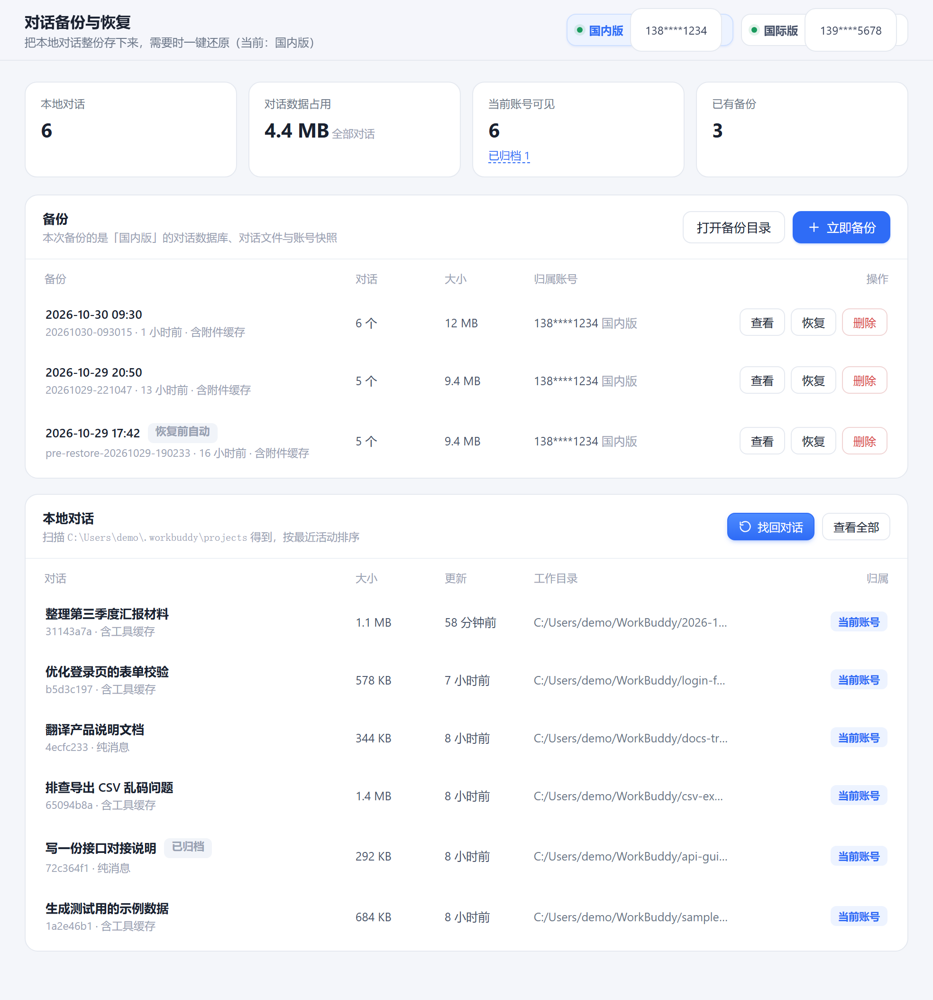

# WorkBuddy 对话管家 · Beta

给 WorkBuddy 的对话做**备份**、**恢复**和**找回**的本地小工具。

纯 PowerShell 脚本 + 一个本地网页界面，解压即用：不用安装、不用 Node、不装依赖，也不联网。
Windows 10 / 11 自带的 PowerShell 5.1 就能跑。

---

## 一、备份

点「立即备份」，把当前版本的**对话数据库、全部对话文件、侧栏快照**打成一个包，存到程序目录的
`backups\<时间戳>\` 下。每一份备份都带一个 `manifest.json`，记录时间、对话数量、体积和内容清单。

- 备份是**整份快照**，不是增量，可以随时拿任意一份回到那个时刻。
- 支持只备份消息、不含附件缓存（体积小很多），也支持连附件一起打包。
- 备份列表里能直接看到每份备份的对话数、大小、归属账号；点「查看」可以看到里面有哪些对话。

## 二、恢复

选中一份备份点「恢复」，两种方式：

| 方式 | 做什么 | 什么时候用 |
|---|---|---|
| **完整恢复** | 把对话库整个回滚到备份那一刻，备份之后新增的对话会从列表里消失 | 想整体回到某个时间点 |
| **仅补齐缺失** | 备份里有、这台机器上没有的才补进来：数据库里缺的对话会插入，磁盘上缺的对话文件会补回，已有的不覆盖、不删除 | 换机器、跨版本迁移、只想把丢的捞回来 |

两种方式都会**先给当前状态自动做一份备份**（名字以 `pre-restore-` 开头），恢复错了可以退回去。
重复点「仅补齐缺失」不会重复插入，是幂等的。

恢复完成后程序不会自己把客户端拉起来，而是问一句：点「好」才打开，点右上角 × 就只刷新页面。

## 三、找回对话

WorkBuddy 把每个对话记在数据库里，每行带一个归属账号。换了账号之后，对话文件明明还在，
但归属还是旧账号，侧栏里就看不见了。

点「找回对话」会扫出所有**不属于当前登录账号**的本地对话，按来源账号分组列出来：

- **正常对话、已归档对话** —— 默认勾选
- **已删除对话** —— 不分账号都会列出来，但默认不勾，需要反悔时自己勾上

勾选后点「找回」：

- 只改归属，**对话正文一个字都不碰**
- 已归档的对话找回后**仍然是归档状态**
- 已删除的对话找回后**取消删除**，重新回到列表里
- 处理前可以选择是否先做一份完整备份（默认开）

云端对话（`transport = cloud`）的归属记在服务端，本地改不了，所以不在候选里，界面会单独提示有几个。

---

## 快速开始

1. 下载后解压到任意目录（路径带中文也没关系）
2. 双击 `启动 WorkBuddy 对话管家.cmd`
3. 浏览器会以应用窗口打开界面，默认就在「对话备份」页

左下角「桌面图标」可以在桌面建一个快捷方式，图标是程序自己画的 WB 方块。

## 运行要求

- Windows 10 / 11
- 系统自带的 PowerShell 5.1（无需安装任何东西）
- 界面用 Edge 或 Chrome 以应用窗口方式打开（系统自带 Edge 即可）

## 它是怎么做到的

- 对话以 **SQLite 数据库**为准（`%USERPROFILE%\.workbuddy\workbuddy.db` 等），
  侧栏那个 `sidebar-list-snapshot.json` 只是渲染缓存，不能当数据源。
- 数据库是 **WAL 模式**。所以程序不直接改文件字节，而是通过 Windows 自带的
  `winsqlite3.dll` 执行 SQL：改动会真正落盘，改完还会跑一次 `PRAGMA integrity_check`。
- 备份里如果带着没合并的事务日志（`-wal`），程序会先把数据库和日志一起复制到临时目录，
  让 SQLite 自己把日志合并进去，得到一份干净的库再操作。
- 所有路径都从环境变量现算（`%USERPROFILE%`、`%LOCALAPPDATA%` 等），
  不写死任何绝对路径，换台机器、换个用户名都能直接用。

## 安全边界

- 程序只监听 `127.0.0.1`，每次启动随机生成 28 位访问令牌，其他程序无法驱动它。
- 全程不联网，不上传任何东西。
- 程序自己产生的数据都在解压目录下的 `data\`、`backups\` 里，删掉程序目录就等于全部清理干净。
- 关掉窗口后后台进程会在十几秒内自己退出，不留残留文件；也可以点左下角「退出程序」。

## 常见问题

**Q：备份会不会把别的账号的对话也带走？**
会。备份是整份数据库快照，不按账号过滤，所以恢复后可能需要用「找回对话」把归属改回来。

**Q：界面几分钟不管再回来就报错？**
v1.3.3 之前有这个问题：浏览器会把不在前台的窗口里的定时器降频，旧版 28 秒收不到心跳就
自己退出了。现在放宽到 100 秒，并且优先检测窗口本身在不在，不会再用着用着就没了。

**Q：改完之后客户端里看不到？**
客户端启动时会重建侧栏缓存，等它初始化完成即可。如果还是看不到，检查对话归属是不是当前账号。

## 声明

本工具与腾讯 / WorkBuddy 官方无关，纯本地自用工具。使用前请自行备份重要数据。
